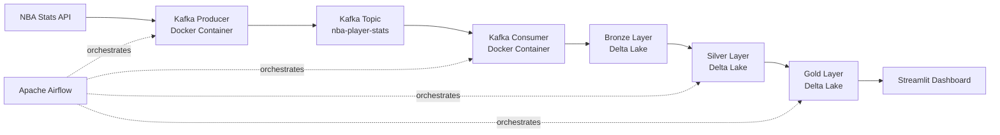

# NBA Analytics Platform

An end-to-end, containerized data engineering pipeline that ingests NBA game data via a streaming architecture, processes it through a medallion lakehouse on Databricks, and serves it through an interactive dashboard — fully orchestrated by Apache Airflow.

## Architecture

## Stack

- **Ingestion:** Python, `nba_api`, Apache Kafka
- **Orchestration:** Apache Airflow (Dockerized, `DockerOperator` + `DatabricksSubmitRunOperator`)
- **Storage & Compute:** Databricks (Unity Catalog, Delta Lake, Serverless SQL)
- **Transformation:** PySpark, medallion architecture (Bronze → Silver → Gold)
- **Dashboard:** Streamlit, Plotly, Databricks SQL Connector
- **Infrastructure:** Docker, Docker Compose

## Pipeline Overview

1. **Bronze (raw ingestion):** A containerized Python producer pulls season game log data from the NBA Stats API and publishes it to a Kafka topic. A containerized consumer reads from Kafka and writes raw records to a Bronze Delta table (append-only, accumulates over time).
2. **Silver (cleaned):** A Databricks notebook reads Bronze, fixes types, derives columns (`IS_WIN`, `IS_HOME_GAME`), and writes a deduplicated, cleaned table (overwrite on each run).
3. **Gold (aggregated):** A second notebook aggregates Silver into team-level home vs. away performance metrics (overwrite on each run).
4. **Dashboard:** Streamlit connects directly to the Gold table via the Databricks SQL Connector and renders interactive comparisons.

The entire pipeline — Kafka ingestion through Gold aggregation — runs as a single Airflow DAG (`nba_analytics_pipeline`), with each stage as a discrete, dependency-ordered task.

## Design Decisions & Known Tradeoffs

- **Bronze uses `append`, Silver/Gold use `overwrite`.** Bronze is the raw source of truth and should accumulate over time; Silver and Gold are fully derivable from what's beneath them, so they're safely recomputed on every run.
- **Kafka ingestion/consumption run as containerized batch tasks, not a long-running streaming service.** The consumer uses a polling loop with an idle timeout to exit cleanly once caught up, rather than running indefinitely — this makes it compatible with Airflow's run-to-completion task model. In a production system, a continuously-streaming consumer would more likely run as its own always-on service outside of batch orchestration.
- **Databricks notebook orchestration uses `DatabricksSubmitRunOperator` with a raw multi-task JSON payload, not the higher-level `DatabricksNotebookOperator`.** At the time of building this, Airflow's `DatabricksNotebookOperator` unconditionally required specifying a cluster (`existing_cluster_id` or `new_cluster`), which is incompatible with a serverless-only Databricks workspace. Databricks' Jobs API does support omitting cluster configuration for serverless notebook tasks, but only via the newer multi-task `tasks` array payload shape — so this pipeline submits that payload directly via `DatabricksSubmitRunOperator` to work around the gap in the higher-level operator.
- **Kafka runs as a single broker with `--replication-factor 1`,** appropriate for a local single-node dev setup; production usage would run multiple brokers with a replication factor of 3.
- **Each portfolio project runs its own dedicated Airflow instance** (rather than sharing one Airflow deployment across projects), so each repo is fully self-contained and runnable independently.

## Running Locally

1. Clone the repo
2. Copy `.env.example` to `.env` and fill in your Databricks host, token, and SQL warehouse HTTP path
3. Start Kafka: `cd kafka && docker compose up -d`
4. Start Airflow: `cd airflow && docker compose up -d`
5. Build the producer/consumer images: `docker compose build`
6. Trigger the `nba_analytics_pipeline` DAG at `localhost:8081`
7. Run the dashboard: `streamlit run dashboard.py`

## Data Source

[NBA Stats API](https://github.com/swar/nba_api) — 2023-24 regular season game logs.